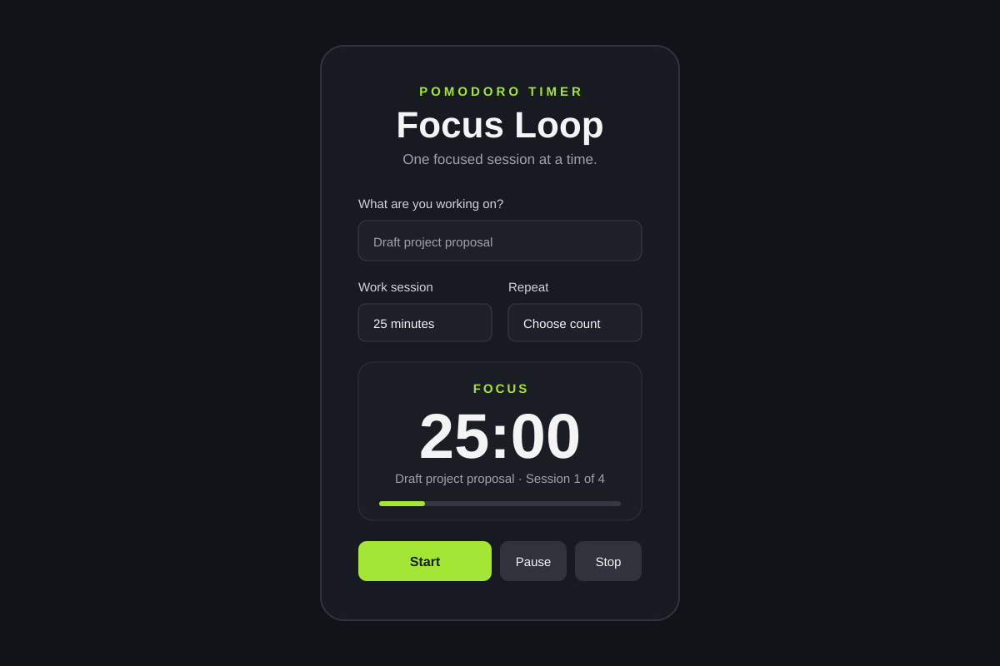

# Focus Loop

A small desktop Pomodoro timer for focused work sessions and five-minute breaks.



## Features

- Enter an activity to work on.
- Choose a work session of 15, 20, or 25 minutes.
- Take an automatic five-minute break between work sessions.
- Run once, repeat a chosen number of sessions, or loop until stopped.
- Pause, resume, and stop the timer.
- Open the desktop app from a `focusloop://` link.

## Requirements

- Node.js LTS
- npm
- Visual Studio Code (recommended)

## Run the app

1. Clone or download this project.
2. Open the project folder in VS Code.
3. Open the integrated terminal.
4. Install dependencies:

   ```bash
   npm install
```

5. Start the desktop app:
``` bash
npm run build
```

The output is created in the dist directory. Install the packaged app before testing custom protocol links.

## Start a timer from a browser link
After installing the desktop app, a webpage can use a focusloop:// link to open it:

``` html
<a href="focusloop://start?minutes=25&mode=count&cycles=4&activity=Writing">
  Start a Focus Loop
</a>
```

Supported query parameters:

| Parameter | Values | Example |
|----------|----------|--------|
| minutes   | 15–25; the app clamps the value to this range   |  minutes=20 |
| mode   | once, count, or infinite   |  mode=count |
| cycles   | 	Number of work sessions for count mode   |  cycles=4 |
| activity   | Activity label   |  activity=Writing |


## Example links:

```text
focusloop://start?minutes=15&mode=once&activity=Reading
focusloop://start?minutes=20&mode=count&cycles=4&activity=Study
focusloop://start?minutes=25&mode=infinite&activity=Planning
```
The operating system or browser may ask the user to confirm opening the desktop app.

## Project files
```
focus-loop/
├── assets/
│   ├── focus-loop-icon.png
│   └── focus-loop-screenshot.svg
├── index.html
├── main.js
├── preload.js
├── renderer.js
├── styles.css
└── package.json
```
### Credits
Built by CodeBox
- Website: https://codeboxllc.net/
- GitHub:  https://github.com/dwilson-coder/
- Bluesky:  https://bsky.app/profile/dwilsoncoder.bsky.social
- LinkedIn: https://www.linkedin.com/in/damion-coder-wilson

## License
Copyright © 2026 CodeBox. All rights reserved.
No part of this project may be copied, modified, distributed, or used without prior written permission from CodeBox.
